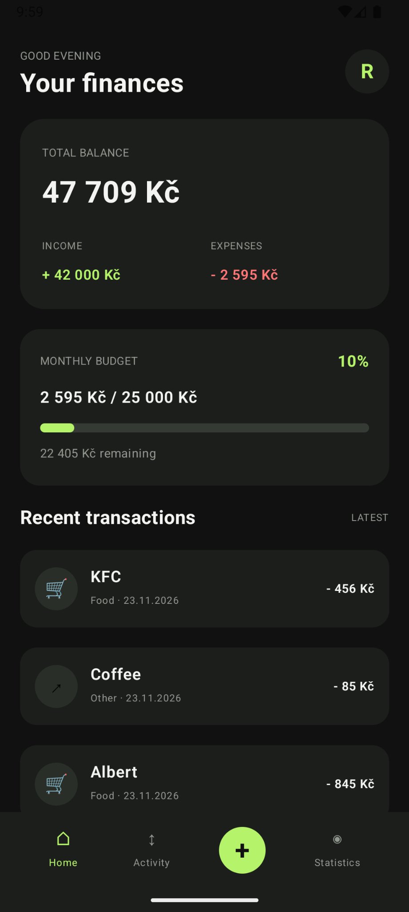
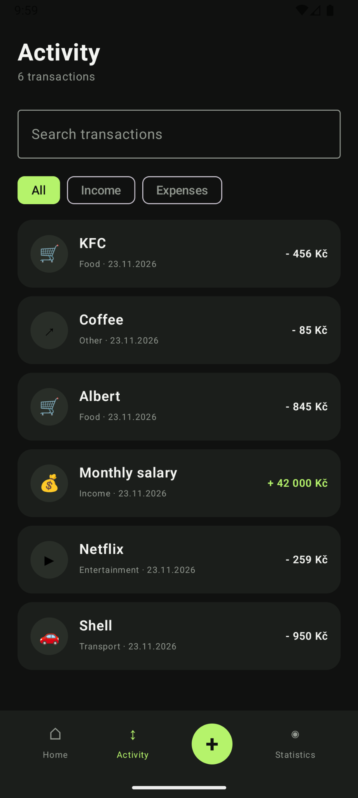
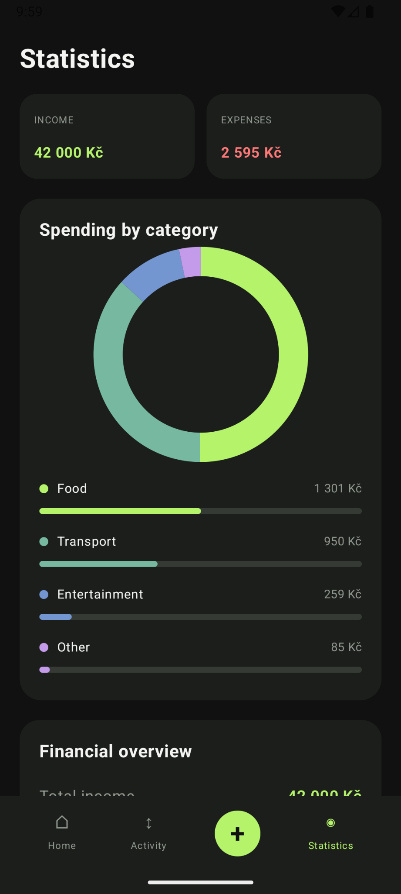
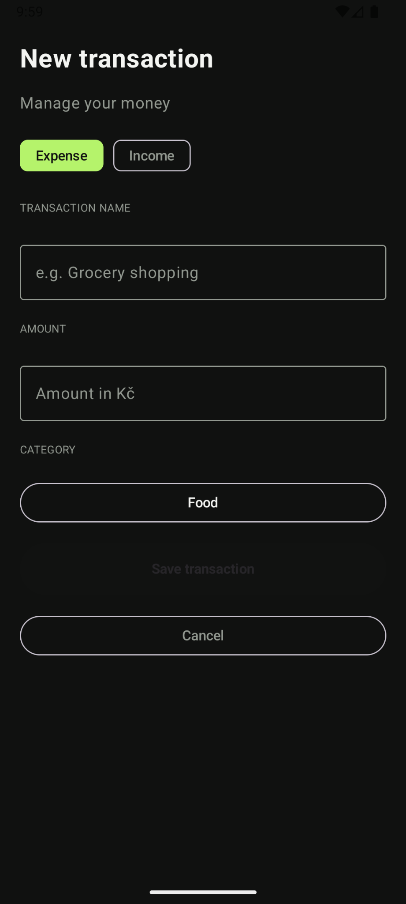

# ExpenseTracker

A personal finance tracking app for Android, built with **Kotlin** and **Jetpack Compose**.

ExpenseTracker provides a simple overview of income, expenses and monthly spending, with transaction history and category-based statistics.

## Screenshots

<p align="center">
  
  
</p>
<p align="center">
  
  
</p>

## Features

- Dashboard with total balance, income, expenses and monthly budget overview
- Add income and expense transactions
- Transaction activity with search and income/expense filters
- Spending breakdown by category
- Local data storage using Room
- Dark interface with a green accent color

## Tech stack

- **Kotlin**
- **Jetpack Compose**
- **Material 3**
- **Room** for local persistence
- **ViewModel**
- **Kotlin Coroutines and Flow**
- **Navigation Compose**

## Project structure

```text
com.radovan.expensetracker/
├── data/        # Room database, DAO, entity and repository
├── ui/          # Compose app, reusable components and screens
├── util/        # Date, money and finance helper functions
└── viewmodel/   # UI state and application logic
```

## Getting started

1. Clone the repository:

   ```bash
   git clone https://github.com/baci29/ExpenseTracker.git
   ```

2. Open the project in Android Studio.
3. Allow Gradle to sync.
4. Run the `app` configuration on an Android emulator or device.

## Tests

The project includes unit tests for finance calculations and money formatting utilities. Run them from the project root:

```bash
./gradlew test
```

## Project status

This is a personal portfolio project created to practise Android development with Kotlin and Jetpack Compose.
